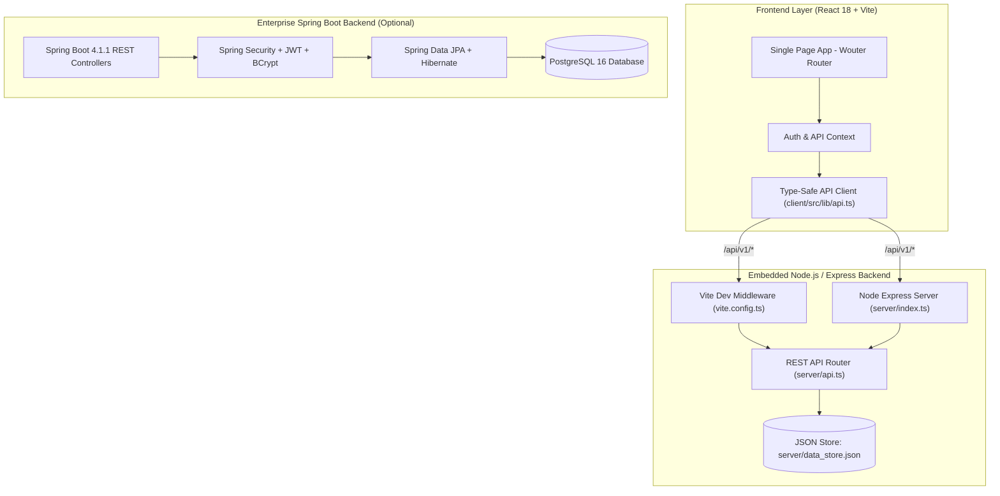

# Job-buddy — Academia-Industry Skill & Placement Portal

<p align="center">
  <b>A unified, evidence-led ecosystem connecting Students, Industry Recruiters, Educational Institutions, and Academicians for skill alignment, career opportunities, and curriculum governance.</b>
</p>

<p align="center">
  <a href="https://job-buddy-hs1e.onrender.com">
    
  </a>
</p>

<p align="center">
  <a href="https://github.com/Kavaykhurana/Job-buddy/actions/workflows/ci.yml">
    
  </a>
  
  
  
  
  
  
  
</p>

---

> 🌐 **Live Production URL**: [https://job-buddy-hs1e.onrender.com](https://job-buddy-hs1e.onrender.com)
> 
> Explore the live application in one click: the sign-in page has **Explore as Student / Recruiter / Institution / Academician** buttons that open each workspace with a sample account. No sign-up needed; demo data resets periodically.

### 🔐 Account access

| Role Workspace | Demo access | Primary Workflow |
| :--- | :--- | :--- |
| 🎓 **Student** | *Explore as Student* (or register) | Skill map, quiz assessment, opportunities, profile & documents |
| 🏢 **Recruiter** | *Explore as Recruiter* | Opportunities, candidates, scorecards, requirements |
| 🏛️ **Institution** | *Explore as Institution* | Readiness, curriculum alignment, analytics |
| 🧑‍🏫 **Academician** | *Explore as Academician* | Training, research, mentorship and collaboration |

Demo sign-in is enabled with `DEMO_LOGINS=true`; without it, only registered students and admin-assigned roles can sign in.

---

## 📑 Table of Contents
- [Job-buddy — Academia-Industry Skill \& Placement Portal](#job-buddy--academia-industry-skill--placement-portal)
    - [🔑 Demo Accounts for Instant Review](#-demo-accounts-for-instant-review)
  - [📑 Table of Contents](#-table-of-contents)
  - [🌟 Executive Overview](#-executive-overview)
  - [🎯 Key Features by Role](#-key-features-by-role)
    - [1. Student Workspace 🎓](#1-student-workspace-)
    - [2. Industry \& Recruiter Workspace 🏢](#2-industry--recruiter-workspace-)
    - [3. Institution \& Placement Cell Workspace 🏛️](#3-institution--placement-cell-workspace-️)
    - [4. Academician \& Faculty Workspace 🧑‍🏫](#4-academician--faculty-workspace-)
    - [5. Policy \& Governance Analytics 📊](#5-policy--governance-analytics-)
  - [🏗️ System Architecture](#️-system-architecture)
  - [📡 REST API Specification](#-rest-api-specification)
    - [🔐 Authentication \& Session](#-authentication--session)
    - [💼 Opportunities \& Jobs (CRUD)](#-opportunities--jobs-crud)
    - [📝 Applications \& Tracking](#-applications--tracking)
    - [👥 Candidates \& Shortlisting](#-candidates--shortlisting)
    - [👤 Profile, Skills \& Documents (CRUD)](#-profile-skills--documents-crud)
    - [📚 Curriculum \& Collaboration](#-curriculum--collaboration)
  - [📂 Project Directory Structure](#-project-directory-structure)
  - [⚡ Quick Start Guide](#-quick-start-guide)
    - [Prerequisites](#prerequisites)
    - [Installation \& Local Execution](#installation--local-execution)
    - [Building for Production](#building-for-production)
    - [🚀 Deploying to Render](#-deploying-to-render)
    - [Java Backend \& Docker Deployment](#java-backend--docker-deployment)
  - [💾 Data Models \& Persistence](#-data-models--persistence)
  - [🔒 Security, Privacy \& Input Validation](#-security-privacy--input-validation)
  - [🧪 Quality Assurance \& Verification](#-quality-assurance--verification)
  - [📄 License](#-license)

---

## 🌟 Executive Overview

**Job-buddy** solves the critical disconnect between academic curriculum outcomes and rapidly evolving industrial skill requirements. Rather than relying solely on self-reported resumes or unverified credentials, Job-buddy implements a **transparent, evidence-led placement and development lifecycle**.

The platform provides:
1. **Objective Skill Scoring & Gap Mapping**: Adaptive assessments that score technical, soft, and domain-specific capabilities.
2. **Direct Requirement Matching**: Interactive side-by-side comparison between student profiles and company criteria.
3. **Comprehensive Opportunity Pipeline**: Full lifecycle tracking for full-time jobs, apprenticeships, internships, and faculty development.
4. **Curriculum Alignment Loops**: Real-time feedback loops allowing universities to adjust course syllabi based on live industry demand trends.
5. **Role-Based Workspaces**: Tailored interfaces and permission boundaries for all stakeholders.

---

## 🎯 Key Features by Role

### 1. Student Workspace 🎓
- **Placement & Opportunity Feed (`/jobs`)**: Browse authenticated opportunity records with skill-fit scores and direct application submissions.
- **Knowledge & Readiness Assessments (`/assessment`)**: Take timed, categorized practice quizzes. Scores are browser-calculated and are not verified credentials.
- **Dynamic Skill Mapping (`/skill-map/industries`, `/skill-map/roles`)**: Explore market alignment across multiple career tracks and pinpoint actionable skill gaps.
- **Student Profile & Document Center (`/profile`)**:
  - **10-Digit Mobile Number Validation & Persistence**: Validated contact details ensuring compliance with national mobile formatting.
  - **Declared & Calculated Skills**: Manage declared skills with real-time sync to backend APIs.
  - **Document Vault**: Register document metadata, track review status, and delete records. Binary storage and institutional verification require a configured storage/verification provider.
- **Season Application Tracker (`/season`, `/applications/:id`)**: Step-by-step audit trail from submission through screening, interviews, and offers.
- **Digital Portfolio (`/portfolio`)**: Public or recruiter-visible showcase of projects, verified credentials, and achievements.

### 2. Industry & Recruiter Workspace 🏢
- **Opportunity & Requirement Publisher (`/recruiter/jobs/new`, `/recruiter/skill-requirements`)**:
  - Publish jobs and internships with explicit level-based skill criteria (Required vs. Preferred).
  - Add, update, and manage company-wide skill requirements with instant API persistence.
- **Candidate Funnel & Shortlisting (`/recruiter/candidates`)**:
  - View matched candidate profiles with computed eligibility decisions and skill coverage.
  - Toggle candidates into shortlisted state with single-click persistence.
- **Interview Scorecards (`/recruiter/interviews/:id`)**: Structured evaluator scoring with transparent feedback records.
- **Assessment Builder (`/recruiter/assessments/new`)**: Author customized technical and aptitude questionnaires for candidate screening.
- **Collaboration Hub (`/recruiter/collaboration`)**: Create and coordinate mentorship circles, guest lectures, hackathons, and research projects.

### 3. Institution & Placement Cell Workspace 🏛️
- **Cohort Readiness Dashboard (`/institution`)**: Track institutional readiness metrics, verified evidence coverage, and cohort placement status.
- **Curriculum Alignment Register (`/institution/curriculum`)**:
  - Compare academic program syllabus coverage against live industry demand signals.
  - Create and persist actionable curriculum review notes (e.g., adding applied SQL modules or cloud computing labs).
- **Institutional Analytics (`/institution/analytics`)**: Monitor funnel progression, student engagement, and recurring skill deficits across cohorts.
- **Integration Management (`/institution/integrations`)**: Connect external LMS providers, certification authorities, and student record systems.

### 4. Academician & Faculty Workspace 🧑‍🏫
- **Faculty Immersion & Opportunities (`/academician/opportunities`)**: Discover faculty internships, research grants, and advisory consultancies.
- **Industrial Training & FDPs (`/academician/training`)**: Enroll in Faculty Development Programs and industry training workshops.
- **Academic Collaboration (`/academician/collaboration`)**: Manage faculty-led mentorship cohorts and joint industry research initiatives.
- **Curriculum Learning Alignment (`/academician/learning-alignment`)**: Interactive SVG-driven visualization comparing teaching outcomes with industry expectations.

### 5. Policy & Governance Analytics 📊
- **Privacy-Safe Aggregate Reporting (`/policy-analytics`)**:
  - Anonymized, cohort-level intelligence for academic deans and regulatory policymakers.
  - Zero exposure of personal identifiable information (PII) while exposing regional skill demand trends and institutional performance benchmarks.

---

## 🏗️ System Architecture

Job-buddy is currently deployed as a single Node.js/Express service serving the React application and its API. The `backend/` directory is a future Java design scaffold and is not part of the active Render deployment.



---

## 📡 REST API Specification

The active endpoints are exposed under `/api/v1` by the Node backend. Non-authenticated business requests are rejected, and role/ownership checks are applied by the API.

### 🔐 Authentication & Session
| Method | Endpoint | Description | Access |
| :--- | :--- | :--- | :--- |
| `POST` | `/api/v1/auth/login` | Authenticate with email, password & role | Public |
| `POST` | `/api/v1/auth/register` | Register a new student account | Public |
| `GET` | `/api/v1/auth/me` | Retrieve current authenticated user profile | Authenticated |
| `POST` | `/api/v1/auth/refresh` | Refresh short-lived JWT token | Authenticated |
| `POST` | `/api/v1/auth/logout` | Invalidate active session and refresh token | Authenticated |

### 💼 Opportunities & Jobs (CRUD)
| Method | Endpoint | Description | Request Body |
| :--- | :--- | :--- | :--- |
| `GET` | `/api/v1/jobs` | Retrieve all job listings | — |
| `POST` | `/api/v1/jobs` | Create a new job opportunity | `{ title, organization, location, type, match, required, preferred, summary }` |
| `PUT` | `/api/v1/jobs/:id` | Update an existing job opportunity | Partial job payload |
| `DELETE` | `/api/v1/jobs/:id` | Remove a job listing | — |

### 📝 Applications & Tracking
| Method | Endpoint | Description | Request Body |
| :--- | :--- | :--- | :--- |
| `GET` | `/api/v1/applications` | List applications (filtered by user role) | — |
| `POST` | `/api/v1/applications` | Submit application for an opportunity | `{ jobId, jobTitle, organization, statement }` |
| `PATCH` | `/api/v1/applications/:id` | Update application review stage | `{ stage }` |

### 👥 Candidates & Shortlisting
| Method | Endpoint | Description | Request Body |
| :--- | :--- | :--- | :--- |
| `GET` | `/api/v1/candidates` | List candidate pool with fit metrics | — |
| `POST` | `/api/v1/candidates/:id/shortlist` | Toggle candidate shortlist status | `{ shortlisted: boolean }` |
| `POST` | `/api/v1/candidates/:id/scorecard` | Submit interview evaluation score | `{ score, recommendation, feedback }` |

### 👤 Profile, Skills & Documents (CRUD)
| Method | Endpoint | Description | Request Body |
| :--- | :--- | :--- | :--- |
| `GET` | `/api/v1/profile` | Retrieve student profile details | — |
| `PUT` | `/api/v1/profile` | Update contact (phone, email) or details | `{ phone, email, declaredSkills }` |
| `POST` | `/api/v1/profile/skills` | Add a new declared skill | `{ skill: string }` |
| `DELETE`| `/api/v1/profile/skills/:skill`| Delete a declared skill | — |
| `POST` | `/api/v1/profile/documents` | Register document metadata for review | `{ title: string }` |
| `DELETE`| `/api/v1/profile/documents/:id` | Remove document record | — |

### 📚 Curriculum & Collaboration
| Method | Endpoint | Description | Request Body |
| :--- | :--- | :--- | :--- |
| `GET` | `/api/v1/curriculum/notes` | List curriculum alignment notes | — |
| `POST` | `/api/v1/curriculum/notes` | Add curriculum review action note | `{ program, note }` |
| `GET` | `/api/v1/initiatives` | List active collaboration initiatives | — |
| `POST` | `/api/v1/initiatives` | Create mentorship/workshop/project initiative | `{ kind, title, org }` |
| `GET` | `/api/v1/requirements` | Get company skill demand matrix | — |
| `PUT` | `/api/v1/requirements` | Update company skill requirement baseline | Matrix payload |

### 💬 Job-buddy Assistant (Gemini)
| Method | Endpoint | Description | Request Body |
| :--- | :--- | :--- | :--- |
| `GET` | `/api/v1/assistant/status` | Whether the assistant is configured (`{ enabled }`) | — |
| `POST` | `/api/v1/assistant/chat` | Streams a reply as newline-delimited JSON: `{type:"delta",text}` events, then `{type:"done"}` or `{type:"error",detail}` | `{ messages: [{ role: "user" \| "model", text }], page? }` |

The floating **Ask Job-buddy** button appears in every workspace once `GEMINI_API_KEY` is set. Gemini is called only from the server, so the key never reaches the browser. Each reply is grounded in a platform guide for the user's workspaces and in the data that user's own endpoints already expose (open listings; plus their profile and applications for students, their postings and candidates for recruiters, recent curriculum notes for institutions and academicians). Limits: 20 messages per conversation, 4,000 characters per message, and 20 messages per user every 10 minutes.

---

## 📂 Project Directory Structure

```plaintext
job-buddy/
├── client/                     # Frontend Application Root
│   ├── index.html              # HTML5 Entry Point & Metadata
│   ├── src/
│   │   ├── assets/             # Vector SVGs, Diagrams, Logos
│   │   ├── components/         # Reusable UI Primitives, AppShell, Navigation
│   │   ├── contexts/           # AuthContext & Session State
│   │   ├── data/               # Seed Data, Constants, Assessment Questions
│   │   ├── lib/                # api.ts (Type-Safe API Client), Utilities
│   │   ├── pages/              # Role Workspaces & Feature Views
│   │   │   ├── AssessmentPages.tsx         # Quiz & Readiness Engine
│   │   │   ├── AuthPages.tsx               # Sign In & Registration
│   │   │   ├── ExtendedRolePages.tsx       # Collaboration, Training & FDPs
│   │   │   ├── LifecycleExtensionPages.tsx # Internships & Projects
│   │   │   ├── RecruitmentCompletionPages.tsx # Job Publisher & Scorecards
│   │   │   ├── RolePages.tsx               # Recruiter, Institution & Academician
│   │   │   └── StudentPages.tsx            # Placement, Profile & Documents
│   │   ├── App.tsx             # Root Router & Toast Config
│   │   ├── index.css           # Design Tokens, Theming, Global CSS
│   │   └── main.tsx            # React DOM Bootstrapper
├── server/                     # Node.js Express REST Backend
│   ├── api.ts                  # Complete REST Router & Business Logic
│   ├── data_store.json         # File-Persisted Database Store
│   └── index.ts                # Production Server Bootstrapper
├── backend/                    # Enterprise Java 21 Spring Boot Service
│   ├── src/main/java/in/jobbuddy/  # Spring Boot Microservice Source Code
│   ├── pom.xml                 # Maven Dependencies & Plugins
│   ├── Dockerfile              # Containerization for Java Backend
│   └── compose.yaml            # Docker Compose Multi-Container Definition
├── package.json                # NPM Scripts & Frontend Dependencies
├── tsconfig.json               # TypeScript Compiler Configuration
├── vite.config.ts              # Vite Bundler & Server Middleware Configuration
└── README.md                   # Project Documentation
```

---

## ⚡ Quick Start Guide

### Prerequisites
- **Node.js**: `v18.0.0` or later (tested on Node v20/v22)
- **Package Manager**: `pnpm` (recommended), `npm`, or `yarn`
- *(Optional for Java Service)*: **Java 21 JDK** & **Maven 3.8+**, **Docker**

### Installation & Local Execution

1. **Clone the repository**:
   ```bash
   git clone https://github.com/your-org/job-buddy.git
   cd job-buddy
   ```

2. **Install frontend and backend dependencies**:
   ```bash
   pnpm install
   ```

3. **Start the unified development server**:
   ```bash
   pnpm dev
   ```
   > 🚀 The application is now live at **`http://localhost:3000`** with zero-latency hot module replacement (HMR) and embedded live REST API endpoints at `/api/v1/*`.

### Building for Production

To validate TypeScript types and build optimized distribution bundles:
```bash
# Typecheck TypeScript source
pnpm check

# Build production client and server bundles
pnpm build

# Run the production Node.js server
pnpm start
```

### 🚀 Deploying to Render

You can deploy Job-buddy to [Render](https://render.com) with 1-click using the included [`render.yaml`](./render.yaml) blueprint:

1. **Via Render Dashboard**:
   - Go to [dashboard.render.com](https://dashboard.render.com) and click **New +** → **Blueprint** (or **Web Service**).
   - Connect your GitHub repository `Kavaykhurana/Job-buddy`.
   - Render will auto-detect `render.yaml`.
2. **Manual Web Service Configuration** (if not using Blueprint):
   - **Environment**: `Node`
   - **Build Command**: `corepack enable && pnpm install && pnpm build`
   - **Start Command**: `node dist/index.js`
   - **Environment Variables**:
     - `NODE_ENV`: `production`
     - `PORT`: `10000` (Render default)
     - `GEMINI_API_KEY`: key from [Google AI Studio](https://aistudio.google.com/apikey); enables the assistant (leave unset to hide it)
     - `GEMINI_MODEL` (optional): Gemini model id, default `gemini-flash-latest`

### Java Backend scaffold

The Java/PostgreSQL files are not currently buildable or deployed. Do not use them as a production deployment path until the service source, migrations, and reverse-proxy configuration are added.
```bash
cd backend
docker compose up --build -d
```

---

## 💾 Data Models & Persistence

The platform utilizes a normalized JSON / PostgreSQL schema designed for high-concurrency role interactions:

```typescript
// Core User Profile Model
interface UserProfile {
  displayName: string;
  email: string;
  phone?: string;                // Enforced 10-digit format
  program: string;
  declaredSkills: string[];
  documents: {
    id: string;
    title: string;
    verified: boolean;
  }[];
}

// Opportunity / Job Model
interface JobOpportunity {
  id: string;
  title: string;
  organization: string;
  location: string;
  type: string;
  match: number;                 // Dynamic skill compatibility score (0-100)
  required: string[];
  preferred: string[];
  summary: string;
  status: "Open" | "Closing soon" | "Review";
}

// Application Lifecycle Model
interface Application {
  id: string;
  jobId: string;
  jobTitle: string;
  organization: string;
  studentName: string;
  studentEmail: string;
  stage: "Application received" | "Screening" | "Interview" | "Offer" | "Rejected";
  appliedAt: string;
  statement: string;
}
```

---

## 🔒 Security, Privacy & Input Validation

1. **Role-Aware Access Boundaries**:
   - Students can only mutate their own profile, applications, and documents.
   - Industry recruiters can only manage opportunities and review candidates relevant to their organization.
   - Deans and Institutional users only access cohort-level aggregate analytics.

2. **Strict Form Sanitization & Validation**:
   - **Phone Numbers**: Strictly sanitized via `raw.replace(/\D/g, "").slice(0, 10)` to prevent invalid characters and enforce an exact 10-digit mobile length with live visual confirmation.
   - **Emails & URLs**: Validated against standard URI/RFC email schemas.

3. **Policy-Preserving Aggregates**:
   - The `/policy-analytics` view guarantees that single student identities are never leaked; all numbers represent grouped statistical thresholds.

---

## 🧪 Quality Assurance & Verification

The project includes an automated test and verification matrix:
- **TypeScript Static Analysis**: `pnpm check` passes with `0` errors.
- **Production Bundle Validation**: `pnpm build` verified with Tree-Shaking and asset optimization.
- **End-to-End Browser Workflows**: Verified in-browser across Chrome and Safari:
  - Adding & deleting declared skills.
  - Uploading & verifying student profile documents.
  - Publishing new recruiter jobs and skill requirements.
  - Adding curriculum review notes with real-time database persistence.

---

## 📄 License

This project is licensed under the **MIT License**. Feel free to use, modify, and distribute it for academic and commercial applications.
